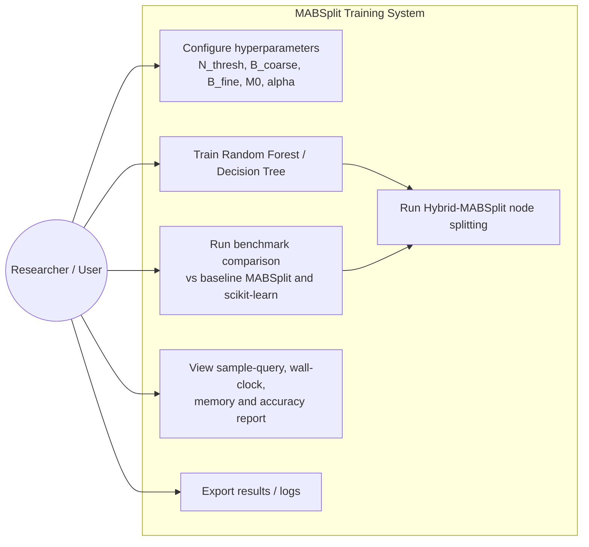
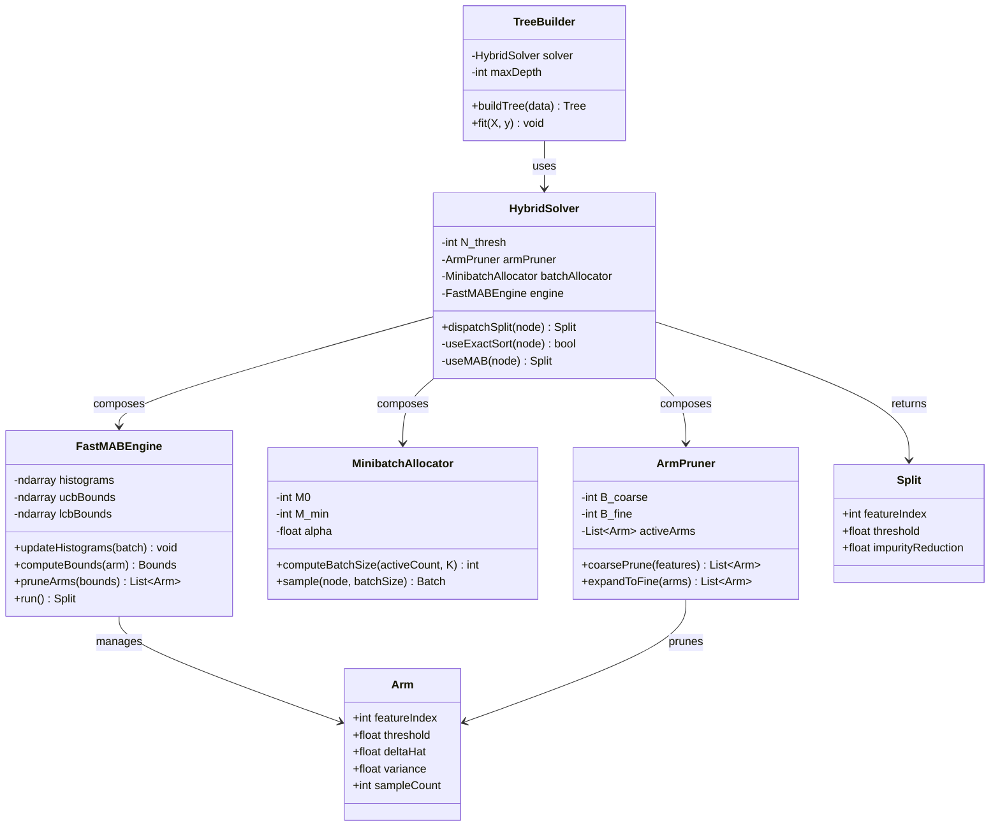
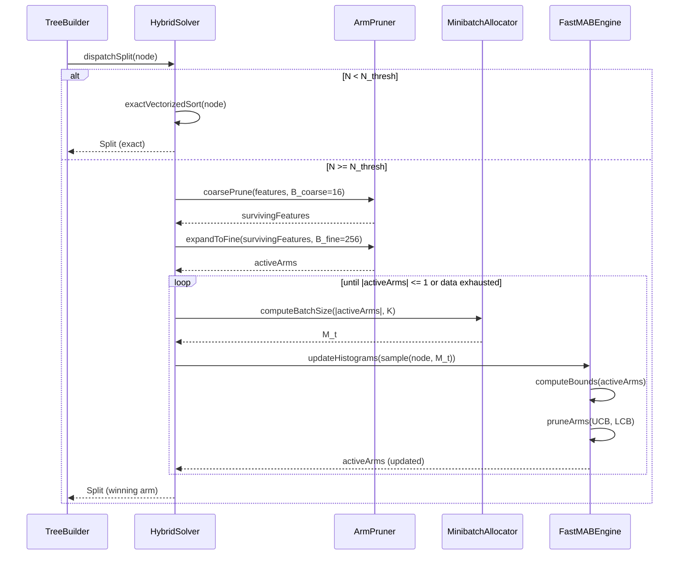
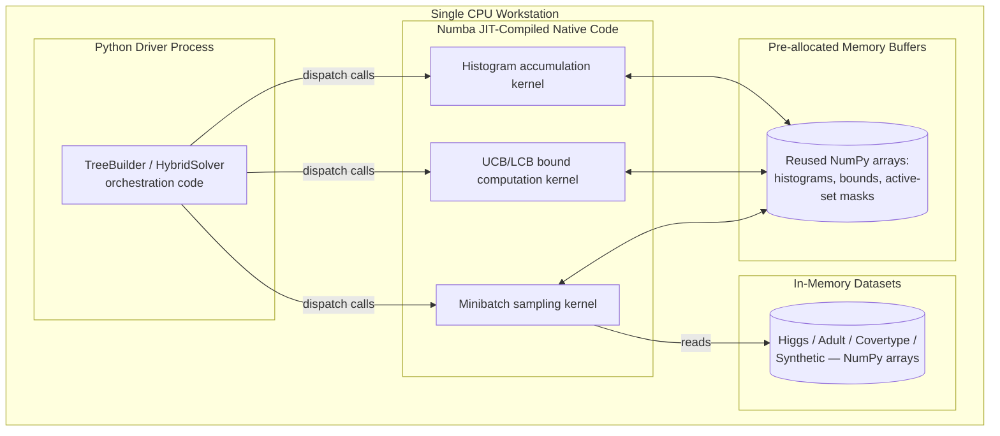

# MABSplit — UML Diagrams (Mermaid)

Corresponds to Synopsis §7.4. Mermaid has no native use-case diagram type, so it's approximated with a flowchart.

## 1. Use-Case Diagram



## 2. Class Diagram



## 3. Sequence Diagram



## 4. Activity Diagram

```mermaid
flowchart TD
    Start([Node created]) --> CheckN{N < N_thresh?}
    CheckN -- Yes --> ExactSort[Exact vectorized sort]
    ExactSort --> ReturnSplit([Return split])

    CheckN -- No --> CoarseHist[Build coarse histograms<br/>B_coarse = 16]
    CoarseHist --> CoarsePrune[Preliminary MAB round:<br/>prune non-competitive features]
    CoarsePrune --> FineExpand[Expand surviving features<br/>to B_fine = 256]
    FineExpand --> InitActive[Initialize active arm set]

    InitActive --> Loop{|Active| > 1 AND<br/>data remaining?}
    Loop -- Yes --> ComputeBatch[Compute adaptive batch size M_t]
    ComputeBatch --> Sample[Draw minibatch, update histograms]
    Sample --> ComputeBounds[Compute impurity delta,<br/>variance, UCB/LCB per arm]
    ComputeBounds --> Prune[Find UCB_min;<br/>retain arms with LCB <= UCB_min]
    Prune --> Loop

    Loop -- No --> ReturnSplit
```

## 5. Deployment Diagram

